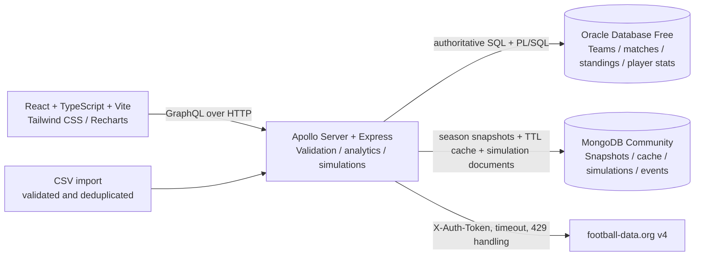

# PitchIQ architecture

## System context



The API fetches the current or requested permitted season from football-data.org and saves successful responses in MongoDB. MongoDB's `football_seasons` collection is the persistent source in `provider-cache` mode; transient `api_cache` entries use TTL. If live access fails, the API may use a persisted real provider snapshot. If neither exists, it returns an empty data set with a visible provider error; it has no fictional-data fallback. When Oracle mode is configured, Oracle remains authoritative for structured result records and the schema currently models one active season. Historical provider snapshots remain separately stored in MongoDB.

## Entity relationship diagram

```mermaid
erDiagram
  TEAMS ||--o{ PLAYERS : registers
  TEAMS ||--o{ MATCHES : hosts
  TEAMS ||--o{ MATCHES : visits
  TEAMS ||--o{ STANDINGS : "has current row"
  MATCHES ||--o{ GOAL_EVENTS : contains
  PLAYERS ||--o{ GOAL_EVENTS : scores
  TEAMS ||--o{ GOAL_EVENTS : credited_to
  PLAYERS ||--o{ PLAYER_MATCH_STATS : records
  MATCHES ||--o{ PLAYER_MATCH_STATS : contains

  TEAMS {
    number team_id PK
    varchar name UK
    varchar crest_url
  }
  PLAYERS {
    number player_id PK
    number team_id FK
    varchar name
    varchar position
    number shirt_number
  }
  MATCHES {
    number match_id PK
    varchar external_id UK
    number matchday
    timestamp_tz match_date
    number home_team_id FK
    number away_team_id FK
    number home_goals
    number away_goals
    varchar status
  }
  GOAL_EVENTS {
    number goal_event_id PK
    number match_id FK
    number player_id FK
    number team_id FK
    number minute
    number is_own_goal
    number is_penalty
  }
  PLAYER_MATCH_STATS {
    number player_match_stat_id PK
    number player_id FK
    number match_id FK
    number minutes_played
    number goals
    number assists
    number penalties_scored
  }
  STANDINGS {
    number team_id PK_FK
    number position UK
    number played
    number won
    number drawn
    number lost
    number goals_for
    number goals_against
    number goal_difference
    number points
    varchar form
  }
```

`database/migrations/001_initial_schema.sql` contains constraints/indexes and the two PL/SQL procedures. Mongo collection/index setup is in `database/mongodb-init.js` and is also performed by the API on a successful Mongo connection.
